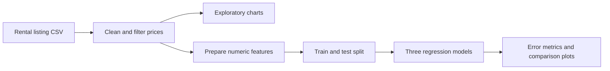

# Apartment Rental Data Analysis

**Explore rental-listing data from cleaning through regression experiments.**

This notebook examines how listing characteristics relate to rental prices. It is useful for practicing Pandas data preparation, exploratory charts, feature engineering, and comparison of regression models in one workflow.

[Open notebook](Ganesh.ipynb) · [Open in Colab](https://colab.research.google.com/github/Balaji91221/apartments_for_rent_classified/blob/main/Ganesh.ipynb)

## What the notebook covers

- Read a semicolon-delimited rental dataset using ISO-8859-1 encoding.
- Filter dollar-formatted prices and convert them to numeric values.
- Plot price distributions, floor area versus price, and averages by bedroom count.
- Encode location fields and prepare a feature matrix.
- Compare linear regression, ridge regression, and gradient boosting using MAE, RMSE, and R².
- Plot feature importance and model-comparison charts.

## Workflow



## Run the notebook

```bash
python -m pip install notebook pandas numpy matplotlib scikit-learn
jupyter notebook Ganesh.ipynb
```

Run from the extracted repository directory. Supply `apartments_for_rent_classified_10K.csv` beside the notebook, or change `file_path` to your dataset location. The CSV must match the notebook's expected column names; it is not included in the repository tree.

## Evaluation caveat

The current feature matrix retains `price_per_sqft`, which is calculated from the target price. This creates target leakage. Remove it and review any other price-derived input before using the reported model scores as evidence of predictive quality. Data cleaning and encoding also happen before the split; a reusable training pipeline would fit preprocessing on training data only.

## Files and contributions

[Ganesh.ipynb](Ganesh.ipynb) contains the analysis. Contributions that document the dataset source, remove leakage, and make preprocessing reproducible are especially useful. This repository is a notebook study rather than a live rental-search or price-quotation service.
